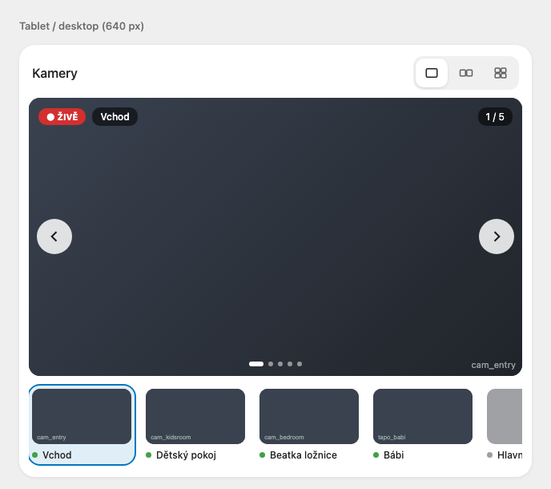
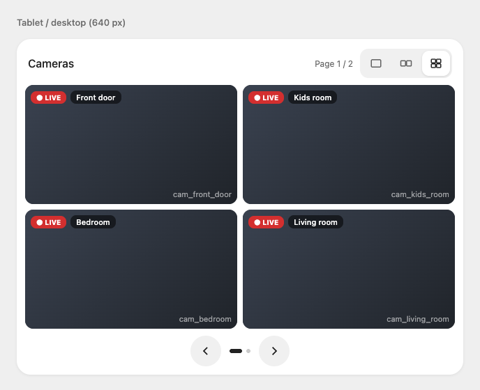

# Camera Deck Card

[](https://hacs.xyz/docs/faq/custom_repositories/)
[](https://github.com/eMalinos/camera-deck-card/actions/workflows/validate.yml)
[](https://github.com/eMalinos/camera-deck-card/releases)

A camera card for Home Assistant dashboards. It shows one camera with a strip of thumbnails, or a two-column grid with 2 or 4 cameras per page. Video comes from [go2rtc](https://github.com/AlexxIT/go2rtc) through the [WebRTC Camera](https://github.com/AlexxIT/WebRTC) integration, so it works on HTTPS and away from home: WebRTC where the network allows it, MSE or HLS otherwise.

| One camera | Grid |
|---|---|
|  |  |

## Features

- **Layout 1**: one camera with previous / next, the position (`2 / 5`) and a scrolling strip of thumbnails with a status dot.
- **Layouts 2 and 4**: a two-column grid, 2 or 4 cameras per page, with page buttons. Tap a camera to open it on its own.
- **Shared layout**: with `layout_entity` (an `input_select` with options `1`, `2`, `4`) every device follows the same layout.
- **Light on the cameras**: only the cameras you can see stream. Thumbnails are go2rtc frames, refreshed every 10 s while the card is visible, so they reuse go2rtc's connection to the camera.
- **Status**: with an `entity`, a camera whose entity is `unavailable` or `unknown` shows OFFLINE and no player.
- **Whole frame**: video is never cropped, so the camera's own overlays (time stamp) stay visible.
- **Playback mode**: a small label shows how the video plays (`RTC`, `MSE`, `HLS`).
- **Sound**: per camera. The button in the heading: in layout 1 for the shown camera (next to privacy), in the grid for every camera on the page; a tile with sound shows a speaker. `sound: true` turns it on when the card loads; a browser that blocks sound before the first tap plays the camera muted, and the first tap anywhere on the page turns the sound on.
- **Full screen**: the button in the heading shows the whole card full screen in its layout (two cameras side by side on a landscape screen, one above the other on a portrait one). The button on a camera shows only that camera with its toolbar. On iPhone, which has no full screen for page elements, the card covers the page instead.
- **Overlays**: LIVE / OFFLINE and the camera name sit top right (cameras usually stamp the time top left) and are hidden on a card narrower than 500 px.
- **Camera switch**: the picture slides left / right (off with the system's reduce-motion setting).
- **PTZ and privacy**: in layout 1, arrow buttons and a privacy toggle for cameras that have them. They are found on the camera entity's device (`button.*_move_left|up|down|right`, `switch.*_privacy`, as the Tapo integration names them) or set with `ptz` / `privacy`.
- Follows your theme's card background and text colours.

## Requirements

- The **WebRTC Camera** integration (HACS), connected to your go2rtc.
- Your cameras as **streams in go2rtc** (`go2rtc.yaml` → `streams:`). The card refers to streams by name, so camera passwords stay in go2rtc.

## Installation

HACS → ⋮ → Custom repositories → `https://github.com/eMalinos/camera-deck-card`, type **Dashboard** → install **Camera Deck Card** → reload the browser.

## Configuration

```yaml
type: custom:camera-deck-card
title: Cameras
layout_entity: input_select.hfb_cameras_layout
cameras:
  - stream: cam_front_door
    name: Front door
    entity: camera.front_door
  - stream: cam_bedroom
    name: Bedroom
    entity: camera.bedroom
    ptz:               # optional, found on the device when left out
      left: button.bedroom_move_left
      right: button.bedroom_move_right
    privacy: switch.bedroom_privacy
    sound: true        # optional, start with sound
```

| Option | Required | Description |
|---|---|---|
| `cameras` | yes | The cameras, in order. |
| `cameras[].stream` | yes | go2rtc stream name. |
| `cameras[].name` | no | Name shown on the camera (default: the stream name). |
| `cameras[].entity` | no | A `camera.*` entity for the OFFLINE status and for finding PTZ / privacy entities on its device. |
| `cameras[].ptz` | no | `button` entities to press, keys `left`, `up`, `down`, `right` (any subset). |
| `cameras[].privacy` | no | A `switch` that hides the picture (privacy mode). |
| `cameras[].sound` | no | `true` to start the camera with sound (default `false`). |
| `title` | no | Heading (default `Cameras`). |
| `layout_entity` | no | `input_select` with options `1`, `2`, `4`. Without it the layout is per device. |

There is no visual editor yet.

## Development

`demo.html` renders the card with a stub player and a fake `hass` (serve the folder, e.g. `python3 -m http.server`, and open `demo.html?layout=1|2|4`). Unit tests: `node --test tests/*.test.mjs`. Browser checks (player lifecycle, strip, thumbnails, sound, full screen): open `tests/dom.html` from the served folder in a browser started with `--autoplay-policy=no-user-gesture-required`, it prints `RESULT PASS`.
